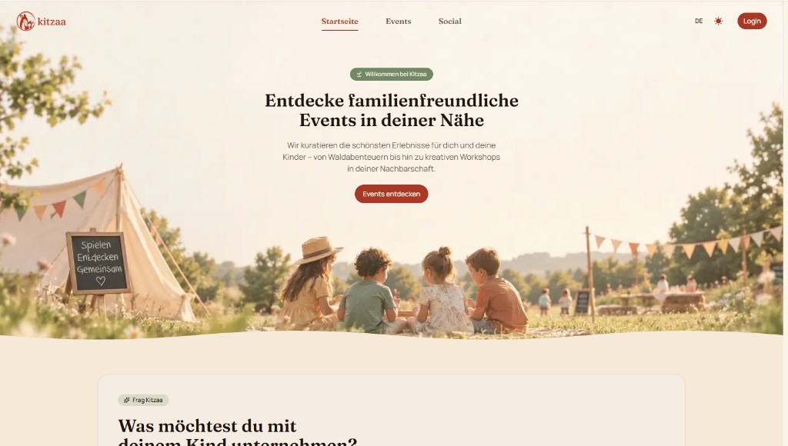
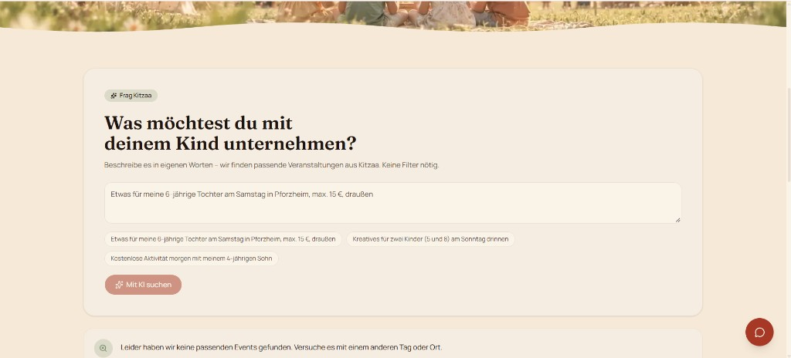

<div align="center">

# KITZAA

Find a family-friendly event nearby, or publish one after it has been reviewed.

[](https://nextjs.org/)
[](https://react.dev/)
[](https://www.typescriptlang.org/)
[](https://tailwindcss.com/)
[](https://expressjs.com/)
[](https://www.mongodb.com/)
[](https://redis.io/)
[](https://socket.io/)

Built by Duygu, Ayla, and Elif.

[Open the app](https://kitzaa.de) · [Admin console](https://admin.kitzaa.de)

</div>

## Overview

Kitzaa is a full-stack platform for discovering and organizing family-friendly workshops, outings, and meetups. Guests browse approved events. Members join them, post in a social feed, and apply to become organizers. A separate admin application moderates what is published.

The public interface is German by default, with English available. The repository is one npm workspace with a public app, an admin app, and an API.

## Live demo

Both addresses responded with HTTP 200 on 2 November 2026.

| Application | Address | Access |
| --- | --- | --- |
| Public app | [kitzaa.de](https://kitzaa.de) | Open |
| Admin console | [admin.kitzaa.de](https://admin.kitzaa.de) | Requires an authenticated user with the `admin` role |

`www.kitzaa.de` redirects to `https://kitzaa.de`. The admin page title is public. The dashboard itself stays behind the admin sign-in check.

## Screenshots

### Home

[](https://kitzaa.de)

### AI event search

[](https://kitzaa.de)

An admin dashboard capture is not in the repository yet.

## Features

- Search approved events by category, age, place, date, organizer, and radius
- Describe a plan in everyday language and receive matching events
- Join an event without exceeding its capacity
- Share posts, comments, replies, and likes
- Apply to become an organizer and manage an institution profile
- Sign in with email and password or Google
- Moderate events, applications, users, and categories from the admin app
- Receive in-app notifications and use a live support chat
- Switch between German and English, and between light and dark mode

## Technology stack

| Area | Choices |
| --- | --- |
| Public app, port 3000 | Next.js 16, React 19, TypeScript, Tailwind CSS 4, shadcn/ui, next-intl, TanStack Query, Zustand, React Hook Form, Zod |
| Admin app, port 3001 | Next.js 16, React 19, TypeScript, Tailwind CSS 4, TanStack Query, TanStack Table, Recharts, Zustand, Zod |
| API | Express 5, TypeScript, MongoDB, Mongoose, Redis, JWT, bcrypt, Zod, Helmet, Socket.IO, Nodemailer, UploadThing |
| AI | Vercel AI SDK. Gemini extracts search filters. Groq writes risk notes and runs the support agent |

## System architecture

```text
Browser
  client :3000          admin :3001
        │  REST, refresh cookie, Socket.IO
        ▼
Express 5
  /api/v1  →  routes → controllers → services
  /api/uploadthing
  /api-docs
        │
        ├── MongoDB     events, users, social, notifications
        ├── Redis       AI search conversation state
        ├── SMTP        account and moderation mail
        └── Gemini / Groq
```

Request bodies are validated with Zod. Responses go through DTO helpers, so routes do not return raw database documents. Role and ownership checks run on the server.

## AI event search

`POST /api/v1/ai/event-search` accepts German, English, or Turkish text. The route allows 20 requests per 15 minutes per IP.

```text
Natural-language query
        ↓
Gemini extracts structured filters
        ↓
A required field is missing
        ↓
Redis stores the partial filters for 30 minutes
        ↓
The next message continues the same conversation
        ↓
The filters become a MongoDB query
        ↓
MongoDB returns the matching events
```

Gemini returns filters only. It does not create events and it does not invent a list. When the required fields are present, the API queries MongoDB and returns at most 20 event records through the public event DTO. Redis keeps the unfinished filters under `conversation:<id>`, so the person can answer one missing detail at a time. A failure in Redis or the model returns HTTP 503.

Two related Groq features stay separate from search. Risk notes on new organizer applications and new events are recommendations for moderators. They do not approve or reject anything. The support agent answers Kitzaa questions in the user's language and can hand an application-status request to an admin.

## Authentication and authorization

- Passwords are hashed with bcrypt at cost 12.
- The access token is a JWT, valid for 1 day, and sent as `Authorization: Bearer`.
- The refresh token is a JWT, valid for 7 days, kept in an `httpOnly` cookie, and rotated on refresh.
- Google sign-in checks the ID token and nonce on the server. The browser does not hold a client secret.
- Roles are `user`, `organizer`, and `admin`. New accounts start as `user`. The organizer role follows an approved application. Paid events require that role.
- `isAdmin`, `isOrganizer`, and `isOwnerOrAdmin` enforce access on the server. The admin layout check is only the interface guard.
- Joining an approved event is an atomic update. The same write checks that the person is not already a participant and that the remaining capacity is enough.

## Project structure

```text
kitzaa/
├── client/          Public Next.js app
├── admin/           Admin Next.js app
├── server/          Express API, Socket.IO, jobs, and AI services
├── docs/screenshots/
└── package.json     npm workspaces: client, server, admin
```

## Local development

Requirements: Node.js 20 or newer, npm, MongoDB, and Redis. SMTP, UploadThing, a Google client ID, and the AI keys are required for mail, uploads, Google sign-in, and the AI features.

```bash
git clone https://github.com/EAD-TECH/kitzaa.git
cd kitzaa
npm install
npm run dev
```

Set the API `PORT` to `8000`. Without it, the API listens on `3000` and collides with the public app. The frontends default to `http://localhost:8000`.

| App | URL |
| --- | --- |
| Public site | http://localhost:3000 |
| Admin | http://localhost:3001 |
| API | http://localhost:8000 |
| Health | http://localhost:8000/health |
| API docs | http://localhost:8000/api-docs |

Run one workspace with `npm run dev -w client`, `npm run dev -w admin`, or `npm run dev -w server`.

### Environment variables

Do not commit `.env` files. `client/.env.example` documents only the Google client ID. The server and admin apps do not yet have an example file.

`server/.env`: `PORT`, `NODE_ENV`, `DB_URI`, `REDIS_URL`, `ACCESS_KEY`, `REFRESH_KEY`, `CLIENT_URL`, `ADMIN_URL`, `API_URL`, `SMTP_HOST`, `SMTP_PORT`, `EMAIL_USER`, `EMAIL_PASS`, `MAIL_FROM`, `UPLOADTHING_TOKEN`, `GOOGLE_CLIENT_ID`, `GOOGLE_GENERATIVE_AI_API_KEY`, `GROQ_API_KEY`. `LMNR_API_KEY` is optional and used for support-agent observability.

`GOOGLE_GENERATIVE_AI_API_KEY` and `GROQ_API_KEY` are the default names read by the AI SDK providers.

`client/.env.local`: `NEXT_PUBLIC_API_URL`, `NEXT_PUBLIC_GOOGLE_CLIENT_ID`, `NEXT_PUBLIC_ADMIN_URL`.

`admin/.env.local`: `NEXT_PUBLIC_API_URL`, `NEXT_PUBLIC_CLIENT_URL`.

Do not put a Google client secret in a frontend env file.

## API

Product routes live under `/api/v1`. Protected routes expect a Bearer access token. Interactive docs are at `/api-docs` while the API is running.

| Prefix | Responsibility |
| --- | --- |
| `/auth` | Register, login, refresh, password reset, Google sign-in |
| `/events` | Discovery, radius search, participation, and event management |
| `/posts`, `/comments` | Social feed |
| `/organizer-applications`, `/institutions` | Organizer workflow |
| `/notifications` | In-app notifications |
| `/ai` | Natural-language event search |
| `/admin` | Moderation. Requires the `admin` role |

Image uploads go to `/api/uploadthing`.

## Testing

From `server/`, `npm test` runs Jest for password rules, Google sign-in, slug generation, and the AI search filter helpers.

From `admin/`, `npm test` starts Jest in watch mode and covers the admin route guard. A single run from that folder is `npx jest --watchAll=false`.

The public client has lint and build scripts and no test script.

## Team

Kitzaa was built by three developers. The areas below follow the Git history. Authentication, events, and organizer applications were continued by more than one person, so those are not assigned to a single author.

### Duygu

- Social feed interface
- Post and comment API
- Google sign-in and profile completion
- Organizer applications and institution management
- AI event search, from the Gemini extraction and Redis conversation state through the MongoDB query and the search interface

Comment handling and the organizer API also include later work from the team. Profile and email-password authentication were shared with Ayla.

### Ayla

- Event discovery, filters, radius search, and event creation
- Event API, event model, and categories
- Registration, password reset, and the larger share of email-and-password authentication

Elif later made substantial changes in the event controller.

### Elif

- Admin dashboard, moderation boards, and admin API
- Notifications, scheduled jobs, and the notification interface
- Socket.IO, support chat, and socket authentication
- Support agent and the Groq risk notes for applications and events

Elif also continued work on the organizer application controller.

## Project background

Kitzaa is the capstone project of a Full Stack Software Development course. The product is a family event platform with a public site, an organizer workflow, and a moderation console. The engineering aim was a typed monorepo with server-side authorization and AI features that stay tied to stored events.

## License

The server package declares the [ISC](https://www.isc.org/licenses/) license. The repository does not yet include a root `LICENSE` file. That choice belongs to all three contributors.
